
<a href="https://kittikarn1752.github.io"><picture>
  <source media="(max-width: 600px)" srcset="assets/hero/hero-mobile.svg">
  
</picture></a>


### Hi, I'm Kittikarn

**Building things with gravity.**

Student learning to code by building games and websites, now digging into AI and networking. I've taken projects to competitions, and one day I'll run my own company. INFJ · dog person · chill gamer.

📍 Bangkok, Thailand

 

<picture>
  <source media="(prefers-color-scheme: dark)" srcset="assets/ui/h-skills-dark.svg">
  <source media="(prefers-color-scheme: light)" srcset="assets/ui/h-skills-light.svg">
  
</picture>

  <a href="https://kittikarn1752.github.io/#web"></a>
  <a href="https://kittikarn.itch.io/weavebound"></a>
  <a href="https://drive.google.com/drive/folders/1tIeXd9xWZULpaP_t0foy6rng-J5VvT90"></a>

  <a href="https://kittikarn1752.github.io/#ai"></a>
  <a href="https://kittikarn1752.github.io/#ios"></a>

<picture>
  <source media="(max-width: 600px)" srcset="assets/stack/stack-mobile.svg">
  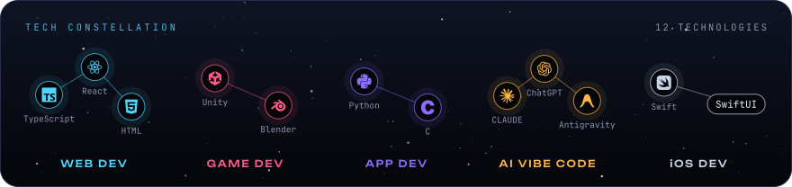
</picture>

<picture>
  <source media="(prefers-color-scheme: dark)" srcset="assets/ui/h-observatory-dark.svg">
  <source media="(prefers-color-scheme: light)" srcset="assets/ui/h-observatory-light.svg">
  
</picture>

<picture>
  <source media="(max-width: 600px)" srcset="assets/stats/telemetry-mobile.svg">
  
</picture>

<picture>
  <source media="(max-width: 600px)" srcset="assets/stats/languages-mobile.svg">
  
</picture>

<picture>
  <source media="(max-width: 600px)" srcset="assets/galaxy/galaxy-mobile.svg">
  
</picture>

<picture>
  <source media="(prefers-color-scheme: dark)" srcset="assets/ui/h-interact-dark.svg">
  <source media="(prefers-color-scheme: light)" srcset="assets/ui/h-interact-light.svg">
  
</picture>

<!-- FEED:START -->

<a href="https://github.com/Kittikarn1752/Kittikarn1752/issues/new?title=feed%7Cstar&amp;body=Press%20**Submit%20new%20issue**%20to%20throw%20a%20star%20into%20the%20black%20hole.%20A%20bot%20adds%20it%20within%20a%20minute%20or%20two%2C%20replies%20here%20and%20closes%20the%20issue.%20Your%20%40handle%20and%20avatar%20will%20appear%20on%20this%20profile.%20One%20star%20per%20person%20per%20hour."><picture>
  <source media="(max-width: 600px)" srcset="assets/game/blackhole-mobile.svg?v=1">
  
</picture></a>

<!-- FEED:END -->

<a href="https://kittikarn1752.github.io"><picture>
  <source media="(max-width: 600px)" srcset="assets/ui/cta-mobile.svg">
  
</picture></a>

<picture>
  <source media="(prefers-color-scheme: dark)" srcset="assets/ui/h-missions-dark.svg">
  <source media="(prefers-color-scheme: light)" srcset="assets/ui/h-missions-light.svg">
  
</picture>

  <a href="https://github.com/Kittikarn1752/Kittikarn1752.github.io"></a>

<b>Ship's log</b> · recent transmissions

<!-- LOG:START -->
- 2026-10-22 · [Pushed to main](https://github.com/Kittikarn1752/Kittikarn1752/commit/61ddd9c7dd968a6d40b56bf555843334fe94473c) · Kittikarn1752/Kittikarn1752
- 2026-10-21 · [Pushed to main](https://github.com/Kittikarn1752/Kittikarn1752/commit/b34d715e813d10ad79a3e740a82bb9c2571fc899) · Kittikarn1752/Kittikarn1752
- 2026-10-22 · [Pushed to main](https://github.com/Kittikarn1752/Kittikarn1752/commit/554500f0dcfaed903a22340bd8fb4cc6af05e341) · Kittikarn1752/Kittikarn1752
- 2026-10-22 · [Created branch main](https://github.com/Kittikarn1752/Kittikarn1752.github.io/tree/main) · Kittikarn1752/Kittikarn1752.github.io
- 2026-10-22 · [Pushed to main](https://github.com/Kittikarn1752/Kittikarn1752/commit/9f57d33755bdda0a16c5b12e94ed7341ea67d516) · Kittikarn1752/Kittikarn1752
<!-- LOG:END -->

<picture>
  <source media="(prefers-color-scheme: dark)" srcset="assets/ui/h-contact-dark.svg">
  <source media="(prefers-color-scheme: light)" srcset="assets/ui/h-contact-light.svg">
  
</picture>

  
  
  
  
  


